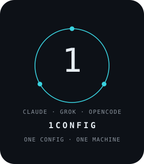

# 1config

<p align="center">
  
</p>

Canonical AI-terminal brain for **Claude Code**, **Grok**, **OpenCode**, and **Cursor Code**. One rules file, one permission policy, one setup script. Lives at `~/.agents/`. Also called the global brain. The trigger `global_brain_update` edits this repo.

License: [MIT](LICENSE). Use it, including commercially. Keep the copyright notice: Brusk Kawa Abdalla and `github:FirstIntegral/1config`. That notice is the credit.

This file is the human report. The machine spec is [`SETUP.md`](SETUP.md). Runtime rules the four tools load every session are [`AGENTS.md`](AGENTS.md). Opinionated choices and *why* are [`docs/DECISIONS.md`](docs/DECISIONS.md).

## Supported systems

| Distro | Status | Package line (setup.sh prints this if something is missing) |
|--------|--------|---------------------------------------------------------------|
| **Omarchy** (Arch) | Supported | `omarchy pkg add python util-linux cronie git gnupg gnome-keyring texlive-meta` |
| **Ubuntu** (Debian) | Supported | `sudo apt-get install -y python3 util-linux cron git gnupg gnome-keyring texlive-full` |
| Other systemd Linux | Best-effort | python3, flock, git, cron, gnupg, gnome-keyring |

Same `setup.sh` on both. No Omarchy-only step in the install path. The Omarchy desktop skill is **gitignored** (machine-local under `skills/`) and never required for the brain to run.

## Fresh machine

```bash
# 1. GitHub auth, then clone into ~/.agents  (HTTPS or SSH)
git clone https://github.com/FirstIntegral/1config.git ~/.agents
# git clone git@github.com:FirstIntegral/1config.git ~/.agents

# 2. Distro packages if the preflight complains
#    Ubuntu:  sudo apt-get install -y python3 util-linux cron git gnupg gnome-keyring texlive-full
#    Omarchy: omarchy pkg add python util-linux cronie git gnupg gnome-keyring texlive-meta
#    then:    sudo systemctl enable --now cron     # Ubuntu
#             sudo systemctl enable --now cronie   # Omarchy/Arch

# 3. Wire the brain (idempotent; launches the 8-page welcome walkthrough on first interactive install)
bash ~/.agents/setup.sh

# 4. Machine-local, once
git config --global user.name  "…"
git config --global user.email "…"
git config --global user.signingkey <YOUR-KEY-ID>   # this machine's key, not another box's
git config --global commit.gpgsign true
bash ~/.agents/hooks/gpg-store-passphrase.sh        # dedicated gnome-keyring collection
gh auth login                                       # so sync.sh can fetch/push

# 5. Optional: resume-from-suspend updater (needs root once)
sudo install -o root -g root -m 0755 ~/.agents/updater/system-sleep-shim.sh \
  /usr/lib/systemd/system-sleep/ai-terminal-tools-update-resume.sh
```

Install the three CLIs (grok, claude, opencode) however you usually do. `setup.sh` does **not** download them; the boot updater only upgrades bins that already exist.

`verify.sh` ending `== PASS (warnings=0) ==` means the brain is installed. A signing warn on the boot dashboard is normal until step 4.

### Omarchy machines: also clone the desktop config pack

The **desktop** config (Hyprland bindings, shell layout, theme, Vigil plugin, OpenTabletDriver/Huion) is a separate public repo: `github:FirstIntegral/omarchy-dots`. The Vigil plugin is its own public repo, `github:FirstIntegral/Vigil` — the pack's `apply.sh` clones and enables it; never vendored. On an Omarchy box, after this brain is installed:

```bash
gh repo clone FirstIntegral/omarchy-dots ~/Projects/omarchy-dots
cd ~/Projects/omarchy-dots && ./apply.sh --dry-run && ./apply.sh
```

From then on the boot dashboard keeps it in sync automatically: `~/Projects/omarchy-dots/sync.sh` runs at every login (fetch → ff-only pull → drift-check `~/.config` vs pack → auto-apply). Non-Omarchy boxes show a gray `–` skip row and never touch it. Playbook: that repo's `README.md`.

`setup.sh` also installs 1config's own bar plugin, `omarchy-plugin/firstintegral.1config/`, into `~/.config/omarchy/plugins/` when that directory exists. The bar face shows this machine's AI usage: Claude, Codex, and Fireworks from Omarchy's records, Grok from its local session ledger and last credits snapshot, OpenCode from its local database. Open the panel and it is a HUD of this repo (rules, install, permissions, hooks, scaffolds, usage), in the brain HUD look. The timer does not call a provider. NixFred's Burn Bar and Infomarchy are the plugins that do this job as separate products; this one stays inside 1config. Ubuntu skips the copy. The bar id is also listed in the omarchy-dots pack; that pack does not install the plugin files.

## Existing machine — pull latest

Works on Omarchy **and** Ubuntu. Same commands:

```bash
cd ~/.agents
git pull origin main
bash ~/.agents/setup.sh
```

`setup.sh` is idempotent: re-copies hooks, refreshes cron jobs, re-fans permissions, rewrites the autostart `Exec=` to *this* `$HOME`. Live CLI versions go to **gitignored** `inventory.local.md`, so an Ubuntu box pulling Omarchy-era versions (or the reverse) no longer fails verify and no longer dirties git with a version-table fight. That table uses login `command -v` first, then the vendor dirs the updater already knows (`~/.opencode/bin`, `~/.grok/bin`, `~/.local/bin`) — Ubuntu's official OpenCode installer is visible even though its PATH line lives behind `.bashrc`'s interactive-guard; an Omarchy mise shim on login PATH still wins. 1config does not edit your `.profile` and does not symlink into `~/.local/bin`.

## Opinionated defaults — read before you fork

These are **this repo's** choices. Other people often want the opposite. They are all reversible; none are hidden.

| Default | Value here | Why | Flip |
|---------|------------|-----|------|
| **`bash_without_prompt`** | **`true`** | Opinionated. A fresh clone gets full Bash autonomy. Generic `git push` does not prompt. Red lines still wait for a yes. | Copy `local.json.example` to gitignored `local.json` (`false`), then `bash ~/.agents/setup.sh`. |
| **`edit_without_prompt`** | `true` | File writes should not stop a session. | Same file, `"edit_without_prompt": false`. |
| GPG commit signing | Required, never `--no-gpg-sign` | Attribution is cryptographic. | Don't. If you must unsigned history, this is the wrong brain. |
| No AI co-author lines | Hard rule | Commits/PRs attributed to the user only. | Don't. |
| Caveman mode | **Always on (full)** | Terse prose. The direction of this repo. | `stop caveman` for one session. Durable opt-out: `local.json` key `caveman` set to `off`. |
| Tool memory stores | Disabled | Facts live in markdown (`AGENTS.md`, `session_compact.md`, `docs/DECISIONS.md`). | Don't recreate `~/.grok/memory/` or Claude topic files. |
| `create_project` / `checkpoint_project` | New simple names land in `~/Projects/<name>`; never `git init`, never add a remote | Project location and publishing are deliberate choices. | Give an explicit path when needed; ask before publishing. |
| TeX | Assumed installed | Papers are LaTeX, never a Markdown fallback. New papers run digit-refuse after latexmk. | Install `texlive-full` (Ubuntu) or `texlive-meta` (Omarchy). |
| Lean 4 | Default on new `writepaper_project` scaffolds | First paper copies `docs/paper/lean/`. Existing papers not backfilled. `setup.sh` does not install elan. | `bash ~/.agents/hooks/install-elan.sh` |
| Android SDK | `$HOME/Android/Sdk` when a project needs one | One root, the path Studio already uses. Not inside a repo. A missing tree is normal. | `setup.sh` does not download it. |
| Paper author block | `git config user.name` and `user.email` | No personal name in the shared rules or the paper template. | Set those two git configs. Empty means stop and ask. |
| Remote check | URLs in `BRAIN_REMOTE` | `sync.sh`, `verify.sh`, and boot sync refuse any other origin. | Forks: edit `BRAIN_REMOTE` only. |

Canonical permission file: [`permissions.json`](permissions.json). Comments in that file are part of the spec.

## What `setup.sh` does *not* do

- No `apt` / `pacman` / `omarchy pkg` (prints the line, you run it).
- No CLI download for grok/claude/opencode.
- No elan/Lean download (`hooks/install-elan.sh` is the install path; setup only probes).
- No Android SDK download. When a project needs one, the only root is `$HOME/Android/Sdk`.
- No GPG key generation and no passphrase prompt (that's `gpg-store-passphrase.sh`).
- No `gh auth login`.
- No rewrite of *your* git `user.signingkey`.
- **Does** set `git config --global gpg.program` to `hooks/gpg-git.sh` (loopback, no pinentry GUI).

## Layout

| Path | Role |
|------|------|
| `AGENTS.md` | Rules every tool loads (via symlinks). Keep lean. |
| `SETUP.md` | Full install spec. Authoritative for AIs recreating the machine. |
| `LICENSE` | MIT. Commercial use is fine. Keep the copyright notice. |
| `BRAIN_REMOTE` | Origin allowlist. Forks change this file, not the scripts. |
| `local.json.example` | Opt-out only. Copy to gitignored `local.json` to leave autonomy or caveman. |
| `permissions.json` | One policy, fanned out to Claude, Grok, and OpenCode. Cursor Code autonomy is per-invocation (`--force`/`--sandbox`). `bash_without_prompt` is true. |
| `setup.sh` / `verify.sh` / `sync.sh` | Install, check, signed push. |
| `hooks/` | GPG unlock, checkpoint, notes-sync, guards, heredoc rewrite, `welcome.js` walkthrough. |
| `boot-dashboard/` | Login status terminal (XDG autostart, Wayland or X11). Exit writes gitignored `close-slip.txt`. |
| `docs/DECISIONS.md` | ADRs for this repo. |
| `inventory.local.md` | Live CLI versions. Gitignored. Login PATH first (mise), then `~/.opencode/bin` / `~/.grok/bin` / `~/.local/bin` so Ubuntu's official installer is visible without shadowing Omarchy mise. |
| `skills/` | Three groups, see [Skills](#skills). Tracked: five on-demand process skills. Untracked: machine-local tool skills. |

## Engineering details (how deep the checks go)

A few examples of the mechanical guards in this repo so nothing silently drifts or hallucinates:

- **Token & spend accounting without provider polling (`omarchy-plugin/firstintegral.1config/bin/usage.py`):**
  - **OpenCode SQLite `step-finish` vs. `session` rollups:** queries `part` rows where `$.type = 'step-finish'` (`input + output + reasoning + cache.read + cache.write` and dollar `$.cost`) joined to `message` per model and per day. Querying the `session` table would double-count old turns whenever `time_updated` moves and miss dollar cost.
  - **Claude 4-bucket token sum:** when `total` is absent in `modelUsage`, sums `inputTokens + outputTokens + cacheReadInputTokens + cacheCreationInputTokens`.
  - **Grok `0–100` percent scale trap:** seeks the tail `1.5 MB` of `~/.grok/logs/unified.jsonl` for `"billing: fetched credits config"` and keeps `creditUsagePercent` on `0–100` (`1.0` = `1%`; rescaling `(0, 1]` turned a fresh `1.0%` week into `100%`). When `isUnifiedBillingUser` is true, one `X` card holds the shared meter for X, Grok, Grok Bot, and Cursor.
  - **Grok Bot base32 blob + hibernation rollover:** base32-decodes `*.blob` stems in `sand-client-persistence/` to read only `.weekly-usage.cache` (leaving chat blobs untouched) and drops any slice where `nextResetMs <= now` even if `expiresAtMs > now`, so hibernating through a weekly reset never sticks last week's `100%` on the bar.
- **Character-exact LaTeX measurement token gate (`hooks/digit-refuse.py`):**
  - Unfolds `\frac{a}{b}` → `a/b`, `\num{...}`, `\,`, and en/em-dashes (`--`), strips the preamble before `\begin{document}`, and expands `\input`/`\include` plus `\newcommand`/`\def` (up to 6 passes) while preserving source line numbers.
  - Extracts fractions (`100/135`), decimals (`0.212`), percents (`45%`), scientific notation (`1.2e3`), en-dash result pairs (`13--2`), and 3+ digit integers while ignoring years (`19xx`/`20xx`) and single-hyphen IDs (`02-23-20174`).
  - Classifies every character into `prose`, `table`, `caption`, `mask` (`\TODO{...}`), or `skip`: every measurement token in `prose` must match a `table` or `caption` token in scope character-for-character, and `pdftotext -layout` verifies nothing in `digit-refuse.deny` rendered into `main.pdf`. Passing `--fuzzy`, `--near`, `--llm`, or `--repo` exits `2` immediately.
- **Context budget & zero double-injection (`hooks/load-project-agents.sh`):**
  - Global `AGENTS.md` is kept at ~1.4% of a 1M-token window (under the 3% ceiling).
  - Claude Code `2.1.277+` loads project `AGENTS.md` natively unless a project `CLAUDE.md` suppresses it. To prevent injecting the file twice into the context window, the `SessionStart` hook checks `claude --version`, `pluginConfigs` instruction mode, and parent dirs for suppressing `CLAUDE.md` files — printing `AGENTS.md` (capped at `AGENTS_CAP=20480` bytes) only when native loading will not happen.
- **Dual-signal staleness & retired token bans (`hooks/watch-stale.sh`, `hooks/kill-tokens.deny`):**
  - `watch-stale.sh` declares `STALE` only when **both** log growth is 0 bytes and `/proc/<pid>/stat` fields 14+15 (`utime+stime`, parsed after the last `)` in `comm`) use `<1s` CPU over the 10-minute window.
  - `hooks/kill-tokens.deny` blocks retired names from re-entering prompts, templates, or LLM stray merges (`merge-strays.sh`).

## Skills

Skills load only when their `description` matches the task. Three groups, three homes:

| Group | Where | Git | Examples |
|-------|-------|-----|----------|
| Machine-local tool skills | `~/.agents/skills/<name>/` | Untracked (`skills/*` in `.gitignore`) | omarchy, diagnose-crash, vigil |
| On-demand process skills | `~/.agents/skills/<name>/` | Tracked in 1config (one `!skills/<name>/` line each) | systematic-debugging, verification-before-completion, receiving-code-review, requesting-code-review, writing-plans |
| Design skills | `~/Projects/skills/<name>/` | That repo | ambient-operations-design, brain-hud-design |

The process skills are adapted from [obra/superpowers](https://github.com/obra/superpowers) at a pinned commit (MIT, Copyright (c) 2025 Jesse Vincent). Each dir keeps `UPSTREAM.md` and `LICENSE.upstream`. Grok and OpenCode read `~/.agents/skills` natively. `setup.sh` step `1b` symlinks each tracked skill into `~/.claude/skills/<name>` and leaves a real directory there untouched. `verify.sh` checks the frontmatter, the credit, and the symlinks. 1config does not link machine-local skills into Claude. Plans written by `writing-plans` go in the project's `docs/plans/` and are committed. To add a tracked skill: create the dir, add its `!skills/<name>/` line, run `setup.sh`.
