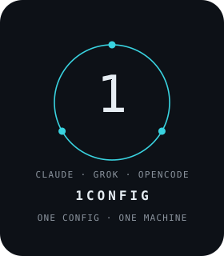

# 1config

<p align="center">
  
</p>

Canonical AI-terminal brain for **Claude Code**, **Grok**, **OpenCode**, and **Cursor Code**. One rules file, one permission policy, one setup script. Lives at `~/.agents/`. Also called the global brain. The trigger `global_brain_update` edits this repo.

License: [MIT](LICENSE). Use it, including commercially. Keep the copyright notice: Brusk Kawa Abdalla and `github:FirstIntegral/1config`. That notice is the credit.

This file is the human report. The machine spec is [`SETUP.md`](SETUP.md). Runtime rules the four tools load every session are [`AGENTS.md`](AGENTS.md). Opinionated choices and *why* are [`docs/DECISIONS.md`](docs/DECISIONS.md). What the guards cover, what they do not, and how to report a hole are in [`SECURITY.md`](SECURITY.md). Read it before you install: by default the agents run shell commands without asking.

## Supported systems

| Distro | Status | Package line (setup.sh prints this if something is missing) |
|--------|--------|---------------------------------------------------------------|
| **Omarchy** (Arch) | Supported | `omarchy pkg add python util-linux cronie git gnupg gnome-keyring texlive-meta` |
| **Ubuntu** (Debian) | Supported | `sudo apt-get install -y python3 util-linux cron git gnupg gnome-keyring texlive-full` |
| Other systemd Linux | Best-effort | python3, flock, git, cron, gnupg, gnome-keyring |

Same `setup.sh` on both. No Omarchy-only step in the install path. The guards and the tool updater run from systemd user units; `cron`/`cronie` in the package line is the fallback for a machine with no user manager, and `setup.sh` leaves exactly one of the two installed. The Omarchy desktop skill is **gitignored** (machine-local under `skills/`) and never required for the brain to run.

## Fresh machine

**Fork first.** This repo is one person's setup, published so you can take it. A direct clone of it does not install: four tracked files say who owns a checkout (`BRAIN_REMOTE`, `BRAIN_SIGNERS`, `NOTES_REMOTE`, `fork-parents.txt`), and until they name you, your own projects are never pushed and the upstream owner's key can ship code to your machine at login. `1config fork-init` rewrites the four for you. `setup.sh` checks all of this before it writes anything, and tells you which step is missing.

```bash
# 1. Fork https://github.com/FirstIntegral/1config on GitHub, then clone YOUR fork into ~/.agents
git clone git@github.com:<you>/1config.git ~/.agents
# git clone https://github.com/<you>/1config.git ~/.agents

# 2. Distro packages if the preflight complains
#    Ubuntu:  sudo apt-get install -y python3 util-linux cron git gnupg gnome-keyring texlive-full
#    Omarchy: omarchy pkg add python util-linux cronie git gnupg gnome-keyring texlive-meta
#    TeX is only for writepaper_project; the install works without it.
#    cron is only the fallback scheduler. Enable it if this machine has no systemd user manager:
#             sudo systemctl enable --now cron     # Ubuntu
#             sudo systemctl enable --now cronie   # Omarchy/Arch

# 3. Git identity and commit signing, once per machine. Every commit here is signed.
git config --global user.name  "…"
git config --global user.email "…"
git config --global user.signingkey <YOUR-KEY-ID>   # this machine's key; gpg --full-generate-key makes one
git config --global commit.gpgsign true

# 4. Once per fork, on the first machine only: point the fork at you
bash ~/.agents/bin/1config fork-init                # the plan: four diffs, changes nothing
bash ~/.agents/bin/1config fork-init --yes          # writes them, one signed commit, no push
#    add  --notes git@github.com:<you>/machine-notes.git  if you keep a private notes repo; without it notes are off

# 5. Wire the brain (idempotent; launches the 8-page welcome walkthrough on first interactive install)
bash ~/.agents/setup.sh --preflight # optional: is this machine ready? changes nothing
bash ~/.agents/setup.sh --dry-run   # optional: print every tool-config diff and the plan, change nothing
bash ~/.agents/setup.sh

# 6. Publish your fork's first commit, and the rest of the machine-local setup
gh auth login                                       # so sync.sh can fetch/push
bash ~/.agents/sync.sh -m "First install"           # verify, signed commit, push to your fork
bash ~/.agents/hooks/gpg-store-passphrase.sh        # only when your key has a passphrase: dedicated gnome-keyring collection

# 7. Optional: resume-from-suspend updater (needs root once)
sudo install -o root -g root -m 0755 ~/.agents/updater/system-sleep-shim.sh \
  /usr/lib/systemd/system-sleep/ai-terminal-tools-update-resume.sh
```

A second machine of yours skips step 4: clone your fork, do steps 2 and 3 with that machine's key, add that key's fingerprint to `BRAIN_SIGNERS` from a machine that is already listed, then run `setup.sh`.

`setup.sh` stops at its preflight, before any write, when signing is not set up, when origin is not in `BRAIN_REMOTE`, or when the newest commit has a signature this machine cannot check. Each line names the command that fixes it.

Install the four CLIs (grok, claude, opencode, cursor-agent) however you usually do. `setup.sh` does **not** download them; the boot updater only upgrades grok, claude, and opencode bins that already exist outside mise.

`verify.sh` ending `== PASS (warnings=0) ==` means the brain is installed. A key with a passphrase shows a signing warn on the boot dashboard until the store script in step 6 has run.

### Omarchy machines: also clone the desktop config pack

The **desktop** config (Hyprland bindings, shell layout, theme, Vigil plugin, OpenTabletDriver/Huion) is a separate public repo: `github:FirstIntegral/omarchy-dots`. The Vigil plugin is its own public repo, `github:FirstIntegral/Vigil` — the pack's `apply.sh` clones and enables it; never vendored. On an Omarchy box, after this brain is installed:

```bash
gh repo clone FirstIntegral/omarchy-dots ~/Projects/omarchy-dots
cd ~/Projects/omarchy-dots && ./apply.sh --dry-run && ./apply.sh
```

From then on the boot dashboard keeps it in sync automatically: `~/Projects/omarchy-dots/sync.sh` runs at every login (fetch → ff-only pull → drift-check `~/.config` vs pack → auto-apply). Non-Omarchy boxes show a gray `–` skip row and never touch it. Playbook: that repo's `README.md`.

`setup.sh` also installs 1config's own bar plugin, `omarchy-plugin/firstintegral.1config/`, into `~/.config/omarchy/plugins/` when that directory exists. The bar face is a ring; hover names the hottest plan. The panel opens on vitals: live checks that this install is correct (checkout, remote, symlinks, permissions, hooks, guards, signing, the plugin copy). Spend is the other page (`s`): Claude and Codex from Omarchy's records, Grok from its local session ledger and last credits snapshot, Grok Bot from its weekly usage cache, OpenCode from its local database and the Go plan endpoint. The timer does not call a provider. NixFred's Burn Bar and Infomarchy are the plugins that do this job as separate products; this one stays inside 1config. Ubuntu skips the copy. The bar id is also listed in the omarchy-dots pack; that pack does not install the plugin files.

## Existing machine — pull latest

Works on Omarchy **and** Ubuntu. Same commands:

```bash
bash ~/.agents/bin/1config pull    # fast-forward only, and only over commits signed by a listed key
bash ~/.agents/setup.sh
```

`1config pull` is the pull the login runs (`hooks/brain-sync.sh`). A bare `git pull` skips the signature gate, so it is not the everyday command.

A commit made on github.com (a merged pull request, an edit in the browser) is not pulled at login or by `1config pull`: the signature gate holds it and the dashboard names it. After you have read it, take it by hand:

```bash
git -C ~/.agents fetch origin main
git -C ~/.agents log -p main..origin/main    # read what is coming
git -C ~/.agents merge --ff-only origin/main
bash ~/.agents/setup.sh
```

`setup.sh` is idempotent: re-copies hooks, refreshes the scheduled guards, re-fans permissions, rewrites the autostart `Exec=` to *this* `$HOME`. Live CLI versions go to **gitignored** `inventory.local.md`, so an Ubuntu box pulling Omarchy-era versions (or the reverse) no longer fails verify and no longer dirties git with a version-table fight. That table uses login `command -v` first, then the vendor dirs the updater already knows (`~/.opencode/bin`, `~/.grok/bin`, `~/.local/bin`) — Ubuntu's official OpenCode installer is visible even though its PATH line lives behind `.bashrc`'s interactive-guard; an Omarchy mise shim on login PATH still wins. `setup.sh` does not edit your `.profile` and links no tool binary. The one link it makes in `~/.local/bin` is its own `1config` command. The boot updater is the exception to name: when it installs a new Claude Code version itself, it repoints `~/.local/bin/claude` at that version, as Claude's own installer does.

## One command, and the way out

```bash
1config status                       # checkout, scheduler, last boot slip
1config verify                       # the same as bash ~/.agents/verify.sh
1config help                         # every command

bash ~/.agents/uninstall.sh          # print what it would remove; change nothing
bash ~/.agents/uninstall.sh --yes    # remove it
```

`setup.sh` links `bin/1config` into `~/.local/bin`. Each command is a thin call to a script in this repo, and the agents keep calling those scripts by path.

`uninstall.sh` removes the rules links, the generated rules, the two Claude hooks, the schedule, the installed script copies, the autostart entry, the `1config` link, and git's `gpg.program`. Each one goes only while it is still what `setup.sh` put there. The permission lists and modes in the three tool configs stay, so a tool keeps running Bash without a prompt until you add `--restore-configs`, which puts back the oldest copies `setup.sh` saved. A tool config that did not exist before the first `setup.sh` is removed again (saved first), so a fresh machine does not keep the autonomy mode. A rules file of your own that `setup.sh` replaced with a link is put back. This checkout, the notes clone, and the keyring stay.

## Opinionated defaults — read before you fork

These are **this repo's** choices. Other people often want the opposite. They are all reversible; none are hidden.

| Default | Value here | Why | Flip |
|---------|------------|-----|------|
| **`bash_without_prompt`** | **`true`** | Opinionated. A fresh clone gets full Bash autonomy. Generic `git push` does not prompt. Red lines still wait for a yes. | Copy `local.json.example` to gitignored `local.json` (`false`), then `bash ~/.agents/setup.sh`. |
| **`edit_without_prompt`** | `true` | File writes should not stop a session. | Same file, `"edit_without_prompt": false`. While Bash autonomy is on, that reaches OpenCode only: Claude and Grok autonomy already covers edits. Turn both off to get edit prompts in all three. Write `true` or `false` without quotes; `setup.sh` stops on a quoted value. |
| GPG commit signing | Required, never `--no-gpg-sign` | Attribution is cryptographic. | Don't. If you must unsigned history, this is the wrong brain. |
| No AI co-author lines | Hard rule | Commits/PRs attributed to the user only. | Don't. |
| Caveman mode | **Always on (full)** | Terse prose. The direction of this repo. | `stop caveman` for one session. Durable opt-out: `local.json` key `caveman` set to `off`. |
| Tool memory stores | Disabled | Facts live in markdown (`AGENTS.md`, `session_compact.md`, `docs/DECISIONS.md`). | Don't recreate `~/.grok/memory/` or Claude topic files. |
| `create_project` / `checkpoint_project` | New simple names land in `~/Projects/<name>`; never `git init`, never add a remote | Project location and publishing are deliberate choices. | Give an explicit path when needed; ask before publishing. |
| Status card | `continue_project` and `checkpoint_project` speak **How things are** (one sentence) and every **Left to do** line. Continue also speaks **Replies** (at most 3) | The open-work list is what the next session needs. The rest of the compact stays unread. **Replies** is the separate cap, so a maintainer comment is not buried in that list. | The rest stays in `session_compact.md`. Append `heard` when the user said that number is heard. |
| TeX | Assumed installed | Papers are LaTeX, never a Markdown fallback. New papers run digit-refuse after latexmk. | Install `texlive-full` (Ubuntu) or `texlive-meta` (Omarchy). The install itself works without TeX: `verify.sh` skips the paper fixtures and says so. |
| Lean 4 | Default on new `writepaper_project` scaffolds | First paper copies `docs/paper/lean/`. Existing papers not backfilled. `setup.sh` does not install elan. | `bash ~/.agents/hooks/install-elan.sh` |
| Android SDK | `$HOME/Android/Sdk` when a project needs one | One root, the path Studio already uses. Not inside a repo. A missing tree is normal. | If `$HOME/Android/Sdk` is absent, stop and name the path. Do not `mkdir` it. Do not run `sdkmanager`. Do not download command-line tools or platforms. |
| Paper author block | `git config user.name` and `user.email` | No personal name in the shared rules or the paper template. | Set those two git configs. Empty means stop and ask. |
| Remote check | URLs in `BRAIN_REMOTE` | `sync.sh`, `verify.sh`, and boot sync refuse any other origin. | Forks: `1config fork-init` rewrites `BRAIN_REMOTE`, `BRAIN_SIGNERS`, `NOTES_REMOTE`, and `fork-parents.txt` from your origin and your signing key. The scripts stay. |
| Incoming commits | Signed by a key in `BRAIN_SIGNERS`, or this machine's signing key | Login installs what it pulls. A push credential alone must not become code. A commit made on github.com waits for a manual pull. | Add a fingerprint to `BRAIN_SIGNERS` (GitHub's web-flow key too, if you accept that trade). |
| Secret scan | On before every brain commit and every checkpoint | Token shapes and private keys stop the commit. `gitleaks` joins in when installed. | Mark a fixture line `gitleaks:allow`. |

Caveman wording in `AGENTS.md` is from [JuliusBrussee/caveman](https://github.com/JuliusBrussee/caveman) (Apache-2.0, Copyright 2026 Julius Brussee): never drop not, never, no, or only; 20 words maximum per sentence; quote code, paths, and errors exactly.

Two lines in `AGENTS.md` are from [DietrichGebert/ponytail](https://github.com/DietrichGebert/ponytail) (MIT, Copyright (c) 2026 DietrichGebert): end each reply with what was skipped or not checked, and a code comment `shortcut: <the limit>, <when to upgrade>`. That is not a second mode. Caveman stays the voice.

`explain_thing` does not replace caveman. It writes gitignored `explain/brief.md` and `explain/diagram.svg` in 80% STE. `explain/page.html` is only when you ask for a page.

Canonical permission file: [`permissions.json`](permissions.json). Comments in that file are part of the spec.

## What `setup.sh` replaces on your machine

Run `bash ~/.agents/setup.sh --dry-run` first: it prints all of this for your machine and changes nothing. Every replaced file is copied to `~/.agents/backups/setup-<timestamp>/` before it changes.

| What you had | What happens | Saved as |
|--------------|--------------|----------|
| Your own `~/.claude/CLAUDE.md`, `~/.grok/AGENTS.md`, `~/.config/opencode/AGENTS.md`, `~/.cursor/AGENTS.md` | Replaced by a link to this repo's `AGENTS.md`. | `rules-claude-CLAUDE.md`, `rules-grok-AGENTS.md`, `rules-config-opencode-AGENTS.md`, `rules-cursor-AGENTS.md` |
| Permission lists in Claude Code, Grok, and OpenCode, **including your own deny rules** | Replaced by the lists in `permissions.json`. Your rules do not survive; add them to `permissions.json` in your fork. Comments in `opencode.jsonc` are dropped. | `claude-settings*.json`, `grok-config-perms.toml`, `opencode-perms.jsonc` |
| Claude auto-memory under `~/.claude/projects/*/memory/` | Each directory is emptied down to a short "disabled" stub, after its copy in the backup compares equal. A `memory` that is a symlink is replaced by a real directory; the folder it pointed at is not touched. A daily guard does the same to anything that reappears. | `claude-memory-<project>/` |
| `~/.grok/memory/` | Deleted after its copy in the backup compares equal, and Grok memory is switched off. | `grok-memory/` |
| `git config --global gpg.program` | Set to `hooks/gpg-git.sh` for every repo on the machine. | not saved; `uninstall.sh` unsets it |
| Login | A status terminal opens at graphical login. Scheduled guards and a tool updater run daily. At login the checkout fast-forwards to signed commits on the remote in `BRAIN_REMOTE` and installs them. | removed by `uninstall.sh` |

## What `setup.sh` does *not* do

- No `apt` / `pacman` / `omarchy pkg` (prints the line, you run it).
- No CLI download for grok/claude/opencode.
- No elan/Lean download (`hooks/install-elan.sh` is the install path; setup only probes).
- No Android SDK download. When a project needs one, the only root is `$HOME/Android/Sdk`. If `$HOME/Android/Sdk` is absent, stop and name the path. Do not `mkdir` it. Do not run `sdkmanager`. Do not download command-line tools or platforms.
- No GPG key generation and no passphrase prompt (that's `gpg-store-passphrase.sh`).
- No `gh auth login`.
- No rewrite of *your* git `user.signingkey`.
- **Does** set `git config --global gpg.program` to `hooks/gpg-git.sh` (loopback, no pinentry GUI).

## Layout

| Path | Role |
|------|------|
| `AGENTS.md` | Rules every tool loads (via symlinks). Keep lean. |
| `SETUP.md` | Full install spec. Authoritative for AIs recreating the machine. |
| `SECURITY.md` | How to report a hole, and the threat model: what each guard covers and what is not defended on purpose. |
| `LICENSE` | MIT. Commercial use is fine. Keep the copyright notice. |
| `BRAIN_REMOTE` | Origin allowlist. Its host and owner are "ours" for checkpoints. Forks change this file, not the scripts. |
| `BRAIN_SIGNERS` | Signer allowlist for incoming commits: one key fingerprint per line. |
| `NOTES_REMOTE` | URL of the private machine-notes repo. |
| `fork-parents.txt` | Forks we contribute back to: `ourOwner/repo parentOwner/repo`. May be empty. |
| `local.json.example` | Opt-out only. Copy to gitignored `local.json` to leave autonomy or caveman. Every key in it changes what `setup.sh` writes; `verify.sh` runs that as a test. |
| `permissions.json` | One policy, fanned out to Claude, Grok, and OpenCode. Cursor Code autonomy is per-invocation (`--force`/`--sandbox`). `bash_without_prompt` is true. |
| `setup.sh` / `verify.sh` / `sync.sh` | Install, check, signed push. `setup.sh --dry-run` previews. `verify.sh --repo` checks only what a clone carries. |
| `uninstall.sh` | Removes what `setup.sh` installed. A plan by default; `--yes` acts. |
| `bin/1config` | One entrypoint for the scripts. Linked into `~/.local/bin`. |
| `.github/workflows/ci.yml` | CI on every pull request and push to `main`: `verify.sh --repo`, ShellCheck at error severity, the skill fixtures, and a real install as a person who is not the owner (`hooks/stranger-install-test.sh`). Read-only token, pinned action. |
| `hooks/` | GPG unlock, checkpoint, notes-sync, guards, heredoc rewrite, `welcome.js` walkthrough, the setup preflight, `fork-init`, and the stranger-install test CI runs. |
| `systemd/` | User units for the guards and the tool updater. `hooks/scheduler.sh` installs them, or cron lines where no user manager runs. |
| `boot-dashboard/` | Login status terminal (XDG autostart, Wayland or X11). Exit writes gitignored `close-slip.txt`. |
| `docs/DECISIONS.md` | ADRs for this repo. |
| `inventory.local.md` | Live CLI versions. Gitignored. Login PATH first (mise), then `~/.opencode/bin` / `~/.grok/bin` / `~/.local/bin` so Ubuntu's official installer is visible without shadowing Omarchy mise. |
| `playbooks/` | One file per trigger or topic: the rule text an agent reads when a row of the table in `AGENTS.md` applies. Not loaded at session start. |
| `skills/` | Three groups, see [Skills](#skills). Tracked: the on-demand process skills listed there. Untracked: machine-local tool skills. |

## Engineering details (how deep the checks go)

A few examples of the mechanical guards in this repo so nothing silently drifts or hallucinates:

- **Token & spend accounting without provider polling (`omarchy-plugin/firstintegral.1config/bin/usage.py`):**
  - **OpenCode SQLite `step-finish` vs. `session` rollups:** queries `part` rows where `$.type = 'step-finish'` (`input + output + reasoning + cache.read + cache.write` and dollar `$.cost`) joined to `message` per model and per day. Querying the `session` table would double-count old turns whenever `time_updated` moves and miss dollar cost.
  - **Claude 4-bucket token sum:** when `total` is absent in `modelUsage`, sums `inputTokens + outputTokens + cacheReadInputTokens + cacheCreationInputTokens`.
  - **Grok `0–100` percent scale trap:** seeks the tail `1.5 MB` of `~/.grok/logs/unified.jsonl` for `"billing: fetched credits config"` and keeps `creditUsagePercent` on `0–100` (`1.0` = `1%`; rescaling `(0, 1]` turned a fresh `1.0%` week into `100%`). When `isUnifiedBillingUser` is true, one `X` card holds the shared meter for X, Grok, Grok Bot, and Cursor.
  - **Grok Bot base32 blob + hibernation rollover:** base32-decodes `*.blob` stems in `sand-client-persistence/` to read only `.weekly-usage.cache` (leaving chat blobs untouched) and drops any slice where `nextResetMs <= now` even if `expiresAtMs > now`, so hibernating through a weekly reset never sticks last week's `100%` on the bar.
- **Character-exact LaTeX measurement token gate (`hooks/digit-refuse.py`):**
  - Unfolds `\frac{a}{b}` → `a/b`, `\num{...}`, `\,`, and en/em-dashes (`--`), strips the preamble before `\begin{document}`, and expands `\input`/`\include` plus `\newcommand`/`\def` (up to 6 passes) while preserving source line numbers.
  - Extracts fractions (`100/135`), decimals (`0.212`), percents (`45%`), scientific notation (`1.2e3`), en-dash result pairs (`13--2`), and 3+ digit integers, ignoring single-hyphen IDs (`02-23-20174`). A number from 1900 to 2099 is checked like any other; a year the prose names gets an `allow-year=` line in `digit-refuse.cfg`.
  - Classifies every character into `prose`, `table`, `caption`, `mask` (`\TODO{...}`), or `skip`: every measurement token in `prose` must match a `table` or `caption` token in scope character-for-character, and `pdftotext -layout` verifies nothing in `digit-refuse.deny` rendered into `main.pdf`. Passing `--fuzzy`, `--near`, `--llm`, or `--repo` exits `2` immediately.
- **Context budget & zero double-injection (`hooks/load-project-agents.sh`):**
  - Global `AGENTS.md` is what every session loads: the hard rules and a table of triggers, about 17 KB (roughly 0.4% of a 1M-token window). `verify.sh` fails above 24,000 bytes. The body of each trigger is a file under `playbooks/` that an agent reads when the trigger fires.
  - Claude Code `2.1.277+` loads project `AGENTS.md` natively unless a project `CLAUDE.md` suppresses it. To prevent injecting the file twice into the context window, the `SessionStart` hook checks `claude --version`, `pluginConfigs` instruction mode, and parent dirs for suppressing `CLAUDE.md` files — printing `AGENTS.md` (capped at `AGENTS_CAP=20480` bytes) only when native loading will not happen.
- **Dual-signal staleness & retired token bans (`hooks/watch-stale.sh`, `hooks/kill-tokens.deny`):**
  - `watch-stale.sh` declares `STALE` only when **both** log growth is 0 bytes and `/proc/<pid>/stat` fields 14 to 17 (`utime`, `stime`, `cutime`, `cstime`, parsed after the last `)` in `comm`), summed over the pid and its descendants, use `<1s` CPU over the 10-minute window.
  - `hooks/kill-tokens.deny` blocks retired names from re-entering prompts and templates.

## Skills

Skills load only when their `description` matches the task. Three groups, three homes:

| Group | Where | Git | Examples |
|-------|-------|-----|----------|
| Machine-local tool skills | `~/.agents/skills/<name>/` | Untracked (`skills/*` in `.gitignore`) | omarchy, diagnose-crash, vigil |
| On-demand process skills | `~/.agents/skills/<name>/` | Tracked in 1config (one `!skills/<name>/` line each) | systematic-debugging, verification-before-completion, receiving-code-review, requesting-code-review, writing-plans, security-audit, writing-for-agents, grilling, migration, tdd, research-paper-writing, research-loop, explain-thing |
| Design skills | `~/Projects/skills/<name>/` | That repo | ambient-operations-design, brain-hud-design |

Five process skills are adapted from [obra/superpowers](https://github.com/obra/superpowers) at `2ce8aa15` (MIT, Copyright (c) 2025 Jesse Vincent). `security-audit` is adapted from [cloudflare/security-audit-skill](https://github.com/cloudflare/security-audit-skill) at `c1c8a8c1` (MIT, Copyright (c) 2025-2026 Cloudflare, Inc.). `writing-for-agents` is adapted from [mattpocock/skills](https://github.com/mattpocock/skills) at `5beb35b0` (MIT, Copyright (c) 2026 Matt Pocock) and loads when `AGENTS.md` or a skill is edited, including `global_brain_update`. `grilling` is the same repo and pin. It loads only when the user says grill, and it does not start on creative work. `migration` is adapted from [JuliusBrussee/caveman](https://github.com/JuliusBrussee/caveman) at `bad48a0e` (Apache-2.0, Copyright 2026 Julius Brussee). It keeps a forward path and a rollback path, and it does not contract unless asked. The upstream `NOTICE` is in that directory. `tdd` is adapted from [mattpocock/skills](https://github.com/mattpocock/skills) at `5beb35b0` (MIT, Copyright (c) 2026 Matt Pocock), with `tests.md` and `mocking.md`. It loads for test-first work. `research-paper-writing` is adapted from [Master-cai/Research-Paper-Writing-Skills](https://github.com/Master-cai/Research-Paper-Writing-Skills) at `77e7c2c1` (MIT, Copyright (c) 2026 Master-cai). It loads only inside `writepaper_project` or a paper file, for prose and claims. Digit-refuse still owns numbers. A full audit waits for a named agent budget, proposes profile `quick` with a cap of 40, and does not run target code: Vigil is not the OS sandbox that skill requires, so those leads stay `needs_validation`. `research-loop` drives [alphaXiv/OpenResearch](https://github.com/alphaXiv/OpenResearch) (`orx`) at `a92fd471` (MIT, Copyright (c) 2026 alphaXiv). It does not vendor OpenResearch. It pre-registers each experiment before launch and checks the experiment DB before a re-run. `bash ~/.agents/skills/research-loop/orx-install.sh` installs the sha256-pinned CLI with telemetry off. Nothing installs it by default. `explain-thing` is original to this repo (MIT, Copyright (c) 2026 Brusk Kawa Abdalla and https://github.com/FirstIntegral/1config). It writes an 80% STE brief and one SVG. HTML is only when you ask. It does not include the ASD-STE100 dictionary, and it is not an ASD product. Each dir keeps `UPSTREAM.md` and `LICENSE.upstream`. Grok and OpenCode read `~/.agents/skills` natively. `setup.sh` step `1b` symlinks each tracked skill into `~/.claude/skills/<name>` and leaves a real directory there untouched. `verify.sh` checks the frontmatter, the copyright line named in `UPSTREAM.md`, and the symlinks. 1config does not link machine-local skills into Claude. Plans written by `writing-plans` go in the project's `docs/plans/` and are committed. To add a tracked skill: create the dir, add its `!skills/<name>/` line, run `setup.sh`.
